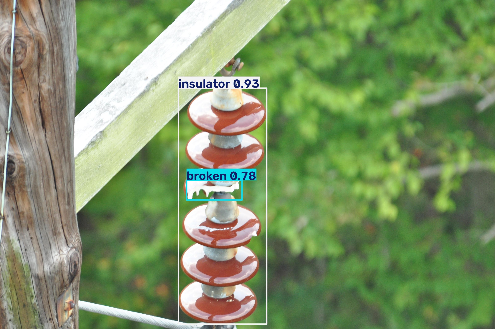
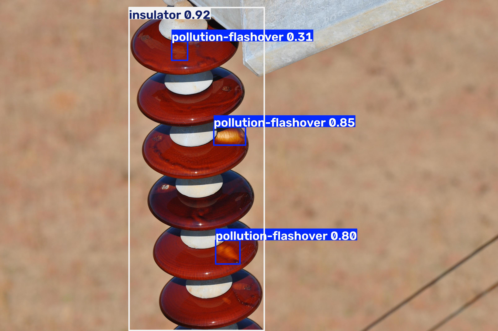

# Automated Power Line Insulator Defect Detection with YOLOv8

An end-to-end computer vision pipeline built with **Ultralytics YOLOv8** to automatically detect, classify, and prioritize power line insulator defects (`broken` and `pollution-flashover`) from aerial and field inspection imagery.

---

## Key Features

- **Multi-Class Defect Detection**: Identifies `pollution-flashover` (class `0`), `broken` (class `1`), and healthy `insulator` (class `2`) instances at high resolution (`960×960`).
- **Class-Specific Confidence Filtering**: Applies tailored post-inference thresholds (`--broken-conf 0.50` for high-precision structural breakage alerts and `--flashover-conf 0.25` for sensitive surface flashover screening).
- **Automated Severity Triage**: Categorizes each inspected image into `CRITICAL` (broken insulator detected), `WARNING` (flashover detected), or `CLEAN` (no defects) and organizes annotated outputs into corresponding folders.
- **Prioritized CSV Reporting**: Exports a ranked `summary.csv` report sorted by severity and maximum confidence score, including per-class defect counts and optional ground-truth recall evaluation.

---

## Model Performance (`deneyC_960`)

Evaluated on the held-out test split (`imgsz=960`, YOLOv8n):

| Metric | Score |
| :--- | :---: |
| **Test mAP@50** | **0.830** |
| **Test mAP@50-95** | **0.534** |
| **AP@50 — `insulator`** | 0.982 |
| **AP@50 — `broken`** | 0.766 |
| **AP@50 — `pollution-flashover`** | 0.743 |

---

## Installation & Usage

### 1. Clone the Repository
```bash
git clone https://github.com/<your-username>/<your-repo-name>.git
cd <your-repo-name>
```

### 2. Create a Virtual Environment & Install Dependencies
```bash
python -m venv venv
# Windows
venv\Scripts\activate
# Linux / macOS
source venv/bin/activate

pip install -r requirements.txt
```

### 3. Run the Inference Pipeline
Place your trained YOLOv8 weights (e.g., `runs/detect/deneyC_960/weights/best.pt`) and run `demo_saha.py`:

```bash
python demo_saha.py \
  --weights runs/detect/deneyC_960/weights/best.pt \
  --source path/to/inspection_images \
  --output demo_cikti \
  --imgsz 960 \
  --broken-conf 0.50 \
  --flashover-conf 0.25
```

**Optional CLI Arguments:**
- `--labels`: Path to YOLO `.txt` ground-truth labels for automatic recall/precision evaluation.
- `--device`: Target compute device (`0` for GPU, `cpu` for CPU; auto-detected by default).
- `--flat-output`: Save annotated images directly in `--output` instead of `CRITICAL/`, `WARNING/`, and `CLEAN/` subdirectories.

---

## Sample Outputs

### Annotated Detections

| Critical — Broken Insulator (`000006140.jpg`) | Warning — Pollution Flashover (`100190.jpg`) |
| :---: | :---: |
|  |  |

### Summary CSV Format (`assets/sample_results.csv`)

```csv
rank,filename,severity,max_confidence,broken_count,flashover_count,ground_truth_defect
1,000006140.jpg,CRITICAL,0.778,1,0,yes
2,100190.jpg,WARNING,0.851,0,3,yes
```

---

## Tech Stack

- **Language**: Python 3.10+
- **Object Detection**: Ultralytics YOLOv8
- **Deep Learning**: PyTorch & Torchvision
- **Image Processing**: OpenCV & Pillow
- **Data Handling**: Pandas & NumPy
